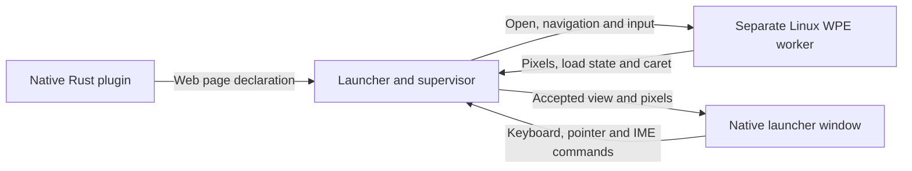

# PR #8 bughunt — PR8R6

## Result and scope

This round found and fixed **four confirmed PR #8 defects**. It also added **one separately identified real-browser coverage improvement**. Coverage is not counted as an implementation bug. Every defect has failing-before and passing-after evidence; the limits of each reproduction are stated below.

The round started at commit `9d0c828f7001ecb1e1e3926c2bc1b1ba1aec3d33` on `feature/page-web-surface`. Scope was [PR #8](https://github.com/yichenchong/CriKey/pull/8), compared with `feature/page-image-canvas`, not an unrestricted cleanup of the repository. The starting working tree was clean. The initial PR contained 54 changed paths: 49 implementation, test, build, schema, SDK and public-documentation paths, plus five previous audit reports. Those previous reports were used to avoid counting old findings again and were not changed.

The unique issue labels for this round are:

- **PR8R6-LAUNCHER-1:** native Unix socket paths were corrupted at the launcher/worker command-line boundary.
- **PR8R6-RUNTIME-1:** a private GLib thread-default context could silently stop browser work while the host still processed its own protocol.
- **PR8R6-UI-1:** unfinished IME text could restore the previous document's composition state after a callback had already closed or replaced it.
- **PR8R6-PACKAGING-1:** packaging through a symlinked checkout could reject Cargo's valid executable records.
- **PR8R6-COVERAGE-1:** real-browser checks now cover pointer position and held buttons, raw keyboard modifiers and input targeting, and DOM focus changes. This is coverage, not another confirmed runtime defect.

The round changes nine existing source/test/build files and adds this report. It does not change dependencies, the lockfile, the public wire schema, permission policy, frame limits, supported platforms, shared plugin endpoint encoding, or the Python and Legacy Compatibility Layer transports.

## Structure and coordination

The relevant code is a Rust workspace with a launcher, a native window/renderer, shared page and protocol types, SDKs, and an optional Linux WPE worker. A plugin declares a web page; it does not supply the browser's pixels. The launcher checks the registered plugin's permissions, starts the separate worker under its existing resource policy, routes input, and accepts validated pixels for the native window.



Eight section owners reviewed the PR, followed by two independent integration reviewers. The coordinator mapped ownership first, routed cross-section findings, selected the fixes, performed centralized builds and runtime checks, and assembled this report. Owners did not run builds, tests, linters or formatters while other owners were editing. Every dispatched agent was instructed to use `/home/yichen/projects/crikey/.venv/bin/python`, never system-wide Python, and to keep imports at module scope even for a function-level fix. All directly invoked Python checks and capture scripts used that virtual-environment interpreter.

Cross-section work was kept under one issue label rather than counted repeatedly. In particular, LAUNCHER-1 involved the launcher producer, the worker parser and the real worker test. RUNTIME-1 required the native adapter's small context check and the Rust runtime's contract and regression. Native adapter ownership was explicitly transferred for that change after its original owner finished. Questions outside a section went back through the coordinator rather than becoming unrelated searches or edits.

### Complete reviewed-file inventory

Each group lists the PR paths assigned to that section. Surrounding unchanged code was read only where needed to understand a consumer, declaration or historical exclusion.

**Engine runtime — 2 paths**

- `crates/crikey-web-host/src/engine.rs`
- `crates/crikey-web-host/src/main.rs`

Reviewed startup and first-command deadlines; initialization and error paths; creator-thread ownership; GLib dispatch; bounded command/output work; callback borrows and pixel lifetime; reader/writer shutdown; surface destruction; native watches; option parsing; and all existing runtime tests. Findings: RUNTIME-1 and the parser half of LAUNCHER-1.

**Native adapter and browser scenarios — 3 paths**

- `crates/crikey-web-host/csrc/ck_web_shim.c`
- `crates/crikey-web-host/csrc/ck_web_shim.h`
- `crates/crikey-web-host/tests/engine_smoke.rs`

Reviewed GObject/backend ownership, callback disconnection, mapped-buffer access, frame release, process-wide loop cleanup, fd/signal source lifetime, keyboard/pointer/wheel/focus conversion, IME conversion to UTF-16, navigation policy, download cancellation, cookies and storage profiles. Added the native-path browser regression and COVERAGE-1. The context guard was then integrated under RUNTIME-1; it is not a second native finding.

**Host helpers — 6 paths**

- `crates/crikey-web-host/src/frame.rs`
- `crates/crikey-web-host/src/ime.rs`
- `crates/crikey-web-host/src/input.rs`
- `crates/crikey-web-host/src/lib.rs`
- `crates/crikey-web-host/src/output.rs`
- `crates/crikey-web-host/src/state.rs`

All six modules were reviewed in full. Checks included terminal state and message direction, surface identity, URL/storage/IME admission, byte and dimension limits, checked stride arithmetic, generation exhaustion, buffer reuse, held-button transitions, focus reset, wheel units, composition order, output replacement order, bounded queues and first-failure handling. No new confirmed helper defect or justified extra test was found. These files remain unchanged.

**Launcher and application — 7 paths**

- `crates/crikey-cli/src/web_host.rs`
- `crates/crikey-cli/src/lib.rs`
- `crates/crikey-cli/src/plugin_commands.rs`
- `crates/crikey-cli/src/settings.rs`
- `crates/crikey-cli/tests/m7_plugin_commands.rs`
- `crates/crikey-app/src/lib.rs`
- `crates/crikey-app/src/plugin_action.rs`

Reviewed permissions before worker construction, exact registered owner lookup, discovery and native arguments, queue limits, stale surface filtering, startup replacement, page closure and activation, persistent-store identity, cgroup mount/delegation selection, inherited memory limits, pre-exec containment, process identity and teardown, doctor diagnostics, and settings residency. Finding: LAUNCHER-1. The actual fallible IME-to-page-close path was supplied to the UI owner for UI-1. No application, doctor or settings change was needed.

**Native UI and rendering — 4 paths**

- `crates/crikey-ui/src/lib.rs`
- `crates/crikey-ui/src/native.rs`
- `crates/crikey-ui/tests/launcher_view_model.rs`
- `crates/crikey-ui/tests/native_renderer.rs`

Reviewed surface identity and frame generations, byte validation, GPU texture reuse and eviction, clip/layout passes, viewport notifications, measured geometry, native versus fallback input, pointer capture, touch ownership, wheel stop/phase, keyboard routing, caret placement, query/chrome isolation, visibility and composition resets. Finding: UI-1. The existing ignored native-window regression was extended rather than creating multiple winit loops in one test process.

**Contracts, permissions and Rust SDK — 12 paths**

- `crates/crikey-core/src/lib.rs`
- `crates/crikey-core/src/page.rs`
- `crates/crikey-native-protocol/src/convert.rs`
- `crates/crikey-native-protocol/src/message.rs`
- `crates/crikey-native-protocol/src/transport.rs`
- `crates/crikey-native-protocol/tests/transport.rs`
- `crates/crikey-native-protocol/tests/wire.rs`
- `crates/crikey-plugin-model/src/permissions.rs`
- `sdk/protocol/crikey/v1/plugin.proto`
- `sdk/rust/src/builder.rs`
- `sdk/rust/src/lib.rs`
- `sdk/rust/tests/page.rs`

Reviewed URL admission and its documented limits, default ephemeral storage, independent network/storage permissions, display-list/web exclusivity, numeric fields and tags, unknown fields, fragmented nested messages and shared decode budgets, conversion defaults, write-timeout semantics, SDK navigate/stay behavior and actual serving tests. No new confirmed issue was found and no schema/API change was made. The shared textual endpoint API deliberately remains unchanged; the new private worker argument was the correct place to fix LAUNCHER-1.

**Build and Linux packaging — 9 paths**

- `Cargo.toml`
- `Cargo.lock`
- `crates/crikey-cli/Cargo.toml`
- `crates/crikey-web-host/Cargo.toml`
- `crates/crikey-web-host/build.rs`
- `packaging/linux/build.sh`
- `packaging/linux/tests/build.test.sh`
- `packaging/linux/rpm/crikey.spec`
- `packaging/linux/flatpak/org.crikey.CriKey.yaml`

Reviewed default-off engine linkage and target gates; WPE development probes and C compilation; supplied versus source-built binaries; successful Cargo artifact selection; target directories; ELF/library checks; staging replacement; runtime notices/workers; Debian dependency selection; RPM dependency generation; and explicitly no-web Flatpak staging. Finding: PACKAGING-1. Independent review caught the necessary output-path companion change described below.

**Public documentation — 6 paths**

- `docs/architecture.md`
- `docs/user-guide.md`
- `docs/plugin-author-guide.md`
- `docs/adr/README.md`
- `docs/adr/0020-plugin-pages.md`
- `docs/spec/crikey-spec-v1.md`

Reviewed the process boundary, supported declaration APIs, rendering forms, generation/lifetime rules, permissions, persistent storage, navigation/download limits, keyboard/settings behavior, IME/accessibility caveats, startup failure, cgroup policy, packaging and dependency claims. No new public-guide error was confirmed. RUNTIME-1's caller restriction belongs in `engine::run` API documentation, which is updated; the guides do not promise arbitrary GLib embedding. Earlier reports and unrelated inherited wording were not rewritten.

## PR8R6-LAUNCHER-1 — native socket path bytes were lost before the real worker connected

### Problem and context

Linux filenames are native byte strings, not necessarily valid UTF-8. A temporary directory can validly contain byte `0xff`. `PrivateEndpoint::create` used `std::env::temp_dir()` and created/bound the Unix socket at the exact native `PathBuf` it received.

The new web-worker spawn path then used `endpoint.endpoint().to_spec()` for `--endpoint`. The existing shared plugin text API's `Endpoint::to_spec()` uses `to_string_lossy()`. That is appropriate only where a textual representation is intended; it cannot preserve an arbitrary native path. A folder ending in bytes `native-\xff` was sent as `native-\xef\xbf\xbd`, the UTF-8 replacement character. Those are different filesystem names. Binding one socket and asking the worker to connect to the other leaves startup waiting for its five-second accept timeout.

There was a second obstacle at the same private boundary: the worker's `Options::parse` required the entire endpoint value to be UTF-8 before using the shared text parser. Even a correctly byte-preserving producer could not pass a native non-UTF-8 path to that parser.

This belongs to PR #8's new supervised web-worker path. It is not a claim that the shared UTF-8 plugin endpoint protocol has been redesigned or fixed for arbitrary native paths.

### Fix and reasoning

The flag and syntax stay **`--endpoint unix:/absolute/path`**. Only their private OS-argument handling changes.

1. `crates/crikey-cli/src/web_host.rs::spawn_contained` now passes `PrivateEndpoint::argument()` rather than the shared lossy text serializer.
2. `PrivateEndpoint::argument()` appends `unix:` and the native socket path to an `OsString`. It reserves their combined byte capacity first, avoiding a prefix allocation followed by reallocation. The existing private constructor guarantees the endpoint is a Unix socket; no alternate flag, fallback directory or compatibility alias was added.
3. `crates/crikey-web-host/src/main.rs::Options::parse` strips the literal native-byte prefix `b"unix:"`, borrows the remaining bytes as a `Path`, and accepts only an absolute, non-NUL Unix path. It allocates the resulting `PathBuf` only after validation. Empty, relative and non-Unix endpoints remain errors. Option names still have their existing rules.
4. Linux-gated imports for `OsStr`, native-byte access and `Path` remain at module scope.

The shared `Endpoint::to_spec()` API, plugin environment protocol and Python transports are unchanged. This fixes the actual new OS boundary rather than rejecting valid temporary-directory bytes or silently choosing a different directory.

### Reproduction and verification

Three separate consumer levels failed on the starting implementation and passed on the fixed source:

- **Production supervisor:** `web_host::tests::real_host_connects_through_a_non_utf8_temporary_directory` runs an isolated copy of the test harness with native `TMPDIR` ending in `native-\xff`. It calls the real production spawner, uses the real installed worker, requires its actual Unix connection, and checks private-endpoint cleanup. It does not change global environment variables in a parallel test process and does not replace the worker with an echo script. The test is explicitly ignored in the ordinary suite because it requires a real worker and writable, memory-enabled cgroup delegation.
- **Worker parser:** `tests::endpoint_preserves_native_socket_path_bytes` requires the parsed endpoint to retain the exact native path. Its companion `endpoint_rejects_empty_relative_and_nul_native_paths` covers refusal boundaries.
- **Real browser:** `non_utf8_unix_endpoint_carries_real_document_frames_and_normal_close` binds a real socket containing `0xff`, starts the real worker with a native argument, loads a local HTTP document, requires its actual validated pixels, and then requires normal Closed/Gone/EOF shutdown. The helper gives HOME/config/profile paths separate UTF-8 names so this case isolates the socket path rather than accidentally exercising WPE's different profile-path restrictions.

Observed starting-revision production failure:

```text
web host did not connect to its private endpoint within 5000 ms:
I/O operation timed out
```

The delegated test run had three existing cleanup cases pass and this new case fail; exit status was 101. The starting parser test failed with `--endpoint must be valid UTF-8`, also exit 101. The starting actual-browser case printed that same usage error and failed because the worker exited before connecting.

On fixed source, all four actual delegated-cgroup tests passed, including the production native-path case. The worker's five option tests and all 15 actual-browser scenarios passed, including native-path document painting and normal closure. The production-spawner test deliberately stops after connection and cleanup; the separate browser case supplies the rendering proof.

## PR8R6-RUNTIME-1 — a private thread-default GLib context could silently stall the browser

### Problem and context

A GLib context is an event queue driven by an event loop. GLib has a process-default context, and a caller can also install a different thread-default context. Reserving the process-default context does not change that thread-default selection.

The host's loop, fd watch and signal watches use the process-default context. The previous round correctly reserved that context for the engine's lifetime so another thread could not dispatch creator-thread callbacks. That earlier fix is not counted again here.

WebKit 2.52.6's internal GLib `RunLoop` first chooses `g_main_context_get_thread_default()` when one is installed, then attaches its work to that context. Exact source: [RunLoopGLib.cpp at the 2.52.6 release](https://raw.githubusercontent.com/WebKit/WebKit/webkitgtk-2.52.6/Source/WTF/wtf/glib/RunLoopGLib.cpp).

A safe caller could therefore do the equivalent of:

```rust
glib::MainContext::new()
    .with_thread_default(|| engine::run(endpoint, None))
```

The host still drove its process-default loop, but WebKit's work was attached to the uniterated private context. The socket loop could process CloseSurface and return success even though the document never requested its HTTP page or painted. This is a different problem from another thread owning the process-default context.

### Actual public-consumer proof

A throwaway external Rust consumer used safe GLib APIs and the exported safe `engine::run`, not a modified engine or linker wrapper. It served a real solid-color localhost HTTP document, sent real framed OpenSurface/CloseSurface messages, validated center RGBA pixels, counted HTTP requests, and recorded load/termination messages. Socket/HTTP deadlines and a 12-second watchdog bounded each process. The private case sent CloseSurface after five seconds if it had not painted.

The same consumer and dependency lock were used before and after the fix. Its GLib crate was 0.20.12; the actual WPE library was 2.52.6.

| Source and caller context | Painted frames observed | HTTP requests | Engine result | Observed elapsed time | Consumer exit |
| --- | ---: | ---: | --- | ---: | ---: |
| Starting source, ordinary process-default | 2 | 1 | `Ok(())`, Closed | 420.9 ms | 0 |
| Starting source, private thread-default | 0 | 0 | `Ok(())`, Closed | 5,011.0 ms | 73 |
| Fixed source, ordinary process-default | 1 | 1 | `Ok(())`, Closed | 939.9 ms | 0 |
| Fixed source, private thread-default | 0 | 0 | `Err(EngineInit(-4))`, StartupFailed | 5.8 ms | 0 |

The last exit 0 means the consumer's **expected-refusal assertions passed**, not that a private-context engine was allowed to run. Frame counts and timings are observations, not performance promises. The ordinary control proves that the local server and real renderer worked; the private starting case proves the context-specific stall rather than a general page-load failure.

### Fix and reasoning

1. `csrc/ck_web_shim.c::ck_web_init` obtains both the process-default and current thread-default context. A non-NULL thread-default different from the process-default now returns the distinct private status `CK_WEB_INIT_UNSUPPORTED_CONTEXT`, value `-4`.
2. This check happens **before** context acquisition, cleanup, WPE initialization or native global-state mutation. NULL and an explicitly selected process-default are supported. The existing foreign-owner refusal, status `-3`, remains in place.
3. `csrc/ck_web_shim.h` defines and documents that private status and the supported context/lifetime contract.
4. `src/engine.rs::run` documents the restriction and the existing one-initialization-attempt policy, including refused attempts. There is no STARTED reset, new retry API, public error variant or context-migration layer. Existing startup handling reports structured StartupFailed for the actual surface.

Rejecting the unsupported context is the narrow safe fix. Forcing or moving every WebKit source to a different context would be a larger engine-integration change and could affect callers' unrelated work.

### Permanent regression

The existing `engine::tests::wpe_process_lifetime_and_native_load_failure_boundaries` test now uses fresh subprocesses before the parent's one WPE initialization:

- A private-context child pushes a genuine GLib context and requires `EngineInit(-4)`. After popping and releasing the private context, a separate thread must acquire/release the process-default, proving no new reservation was leaked by the refusal.
- A separate child explicitly pushes the real process-default and requires successful native initialization and cleanup. This protects explicit default selection. GLib's getter reports `NULL` when the global-default context is selected, as [documented](https://docs.gtk.org/glib/type_func.MainContext.get_thread_default.html), even if the caller explicitly pushes it.
- Existing foreign-owner `-3`, process-once refusal, load-callback and wake-socket checks remain intact.

The child cases have 10-second watchdogs and a distinct expected completion status. Their expected `-4` value is local test data, so the tests-only patch compiles on the original source without the new C macro.

On the starting source the private child did not receive `EngineInit(-4)`; the parent reported child exit 101 instead of its success status 43. The selected regression exited 101. On fixed source it passed within the complete 78-test engine library suite. The separate public consumer then proved normal real painting and fast structured refusal through `engine::run`.

This does not promise arbitrary embedding after unrelated external WPE initialization. The host still owns its sole WPE initialization attempt; private contexts are explicitly unsupported, not newly implemented.

## PR8R6-UI-1 — an old IME preedit could overwrite the replacement document's reset

### Problem and production path

An IME preedit is unfinished text being composed by an input method. The native UI tracks whether composition is active so keys such as Enter do not also run a launcher result while an input method is using them.

At the starting revision, `NativeApplication::window_event` dispatched a `UiCommand::WebIme` before applying that event's final `self.ime.update(&ime)` bookkeeping. Dispatch invokes the host callback and immediately accepts its newest view. Accepting a closed or replaced document calls `NativeImeState::set_surface`, correctly resetting composition for the new target. Execution then returned to the old preedit event and set `composing = true` again under that new target.

A production callback can really close the page at this point:

1. The CLI handles `UiEffect::WebIme` by calling `web_page.send_ime(event)`.
2. The supervisor's bounded send can fail.
3. The error path calls `close_failed_web_page`, closing the worker, plugin page and view-model page.
4. The callback publishes the changed frame through the native handle.
5. Immediate native frame acceptance resets composition, before the old event's remaining bookkeeping ran.

The old ordering could leave the query or replacement marked as composing. In the reproduced closed-page case, the query's next Enter produced no `ExecuteDefault` command. Later platform IME events can clear the stale state, which makes this a latent ordering defect rather than a claim that every page closure always loses keys.

### Fix

In `crates/crikey-ui/src/native.rs::NativeApplication::window_event`, IME bookkeeping now happens **before** translated commands invoke the host callback. The old final-match bookkeeping arm is removed. If the callback accepts a closed or replaced surface, that new target's reset is now the last state update.

No keyboard policy, public API, surface-ID format or callback command order changes. The comment states why callback-driven ownership changes must win over the retired preedit.

### Real-window regression and observed failure

The existing ignored test `native::web_input_tests::native_touch_dispatch_precedes_ime_and_cannot_retarget_after_redraw` was extended, retaining one winit event loop. It uses a real X11 window and GPU surface. `xdotool` injects Enter through XTEST; the test captures the resulting native winit event. It then synchronously dispatches that event immediately after injected preedit/callback transitions, before an unrelated queued platform IME-disable event could hide the defect.

The callback publishes a real replacement `ViewModel` through `NativeLauncherHandle::submit_frame`, so the test exercises the actual callback, frame publication, immediate acceptance and next keyboard consumer. It checks command sequences rather than merely checking a private Boolean:

- Closed document: old surface 44 preedit, then query `ExecuteDefault`.
- Unchanged document: old surface 44 preedit, then Enter routed to surface 44.
- Replaced document: old surface 44 preedit, then Enter routed to surface 45.

On the starting source, the closed-document case recorded only:

```text
[WebIme(Preedit {
    surface_id: 44,
    text: "retired-preedit",
    cursor: Some((15, 15))
})]
```

The required `ExecuteDefault` was missing. The actual-window test failed with exit 101. With the fix, the same final regression passed with a real window and XTEST Enter.

### Integration corrections to this regression

Independent review found that the initial new fixture called blocking `xdotool search --sync ... windowfocus --sync` inside `resumed()`. Its event-loop deadline could not run while that call was blocked. The final fixture spawns and observes the child with a five-second setup deadline, kills and reaps it on timeout, then starts a separate five-second native-key delivery deadline. Its title includes the process ID so simultaneous test processes cannot select each other's window.

Redundant new assertions against private composition state and the already-proven surface ID were removed. The observable next-command, delivery-order and current-target assertions remain. These are refinements to UI-1's regression, not additional defects attributed to the original codebase. The final tests-only fixture was used for the baseline reproduction as well as the fixed run.

Touch and IME events in this test are injected winit events. Only Enter comes through XTEST. This proves dispatcher and callback behavior; it does not claim physical touchscreen input or an actual ibus/fcitx candidate-window session.

## PR8R6-PACKAGING-1 — a symlinked checkout rejected valid Cargo artifacts

### Problem

The packaging script obtained `repository_root` with plain shell `pwd`, which can preserve the logical path through a symlink. Cargo uses the physical current-directory path. The executable selector correctly requires an exact manifest-path match to prevent unrelated or stale binaries from being packaged, but it compared Cargo's physical manifest path with the script's logical alias.

For example, a shell inside `/tmp/pr8r6-cargo-alias`, pointing to `/home/yichen/projects/crikey`, retained the alias while real Cargo reported:

```text
SHELL_LOGICAL_ROOT=/tmp/pr8r6-cargo-alias
CARGO_MANIFEST_PATH=/home/yichen/projects/crikey/crates/crikey-cli/Cargo.toml
```

That observation used actual Cargo 1.86 metadata through the alias. Cargo's directory behavior is also documented in [Cargo's GlobalContext initialization](https://github.com/rust-lang/cargo/blob/rust-1.86.0/src/cargo/util/context/mod.rs#L342-L345) and Rust's [`current_dir` implementation contract](https://doc.rust-lang.org/1.86.0/std/env/fn.current_dir.html).

The original recording Cargo fixture emitted `$PWD` and therefore repeated the script's logical path. It hid this difference. A successful real build through an alias could be rejected before staging even though it reported the correct binaries.

### Fix and complete packaging changes

1. `packaging/linux/build.sh` obtains `repository_root` with `pwd -P`, resolving symlinks. Strict manifest, package, binary-kind/name, non-test, uniqueness and absolute-executable checks remain unchanged.
2. The script also resolves the existing output directory with `pwd -P`. This is a necessary companion: `flatpak()` excludes an in-checkout build workspace by comparing its path prefix with the repository root. Making only the repository physical would leave an explicitly aliased output logical, so those two identities would no longer match.
3. The inline comment documents both Cargo artifact identity and Flatpak workspace exclusion.
4. `packaging/linux/tests/build.test.sh` models real Cargo behavior by computing the recording fixture root with `pwd -P`, using it for emitted manifest paths and relative target roots.
5. The new alias source-build regression invokes the real packaging driver through a checkout symlink and compares all four staged no-web executable payloads with their fixtures.
6. The added Flatpak case uses an explicitly aliased in-checkout output and requires a staged source entry point while requiring the current workspace to be absent from those staged sources.

The first narrow fix passed 96 packaging checks. Independent integration review then identified the output-path mismatch that this initial stage-only regression did not cover. The companion normalization and Flatpak consumer assertion were added before publication; the final suite passes 97 checks. The possible self-inclusion from the intermediate path mismatch was identified from the actual prefix comparison, not claimed as a separately executed original-revision Flatpak failure.

### Before/after proof and limits

A tests-only patch corrected the fixture's physical paths and added the checkout-alias case on the starting revision. The baseline suite reached that case and aborted with exit 1:

```text
build.sh: Cargo did not report exactly one executable artifact for crikey-cli/crikey
```

It stopped at the actual driver invocation before the new staged-byte checks, so no invented full-suite failure count is assigned to that aborted run. The final fixed suite completed with **97 passed, 0 failed**. Both changed shell files also passed explicit separate `bash -n` checks.

The fixture exercises real packaging, artifact selection, staged payloads and source-archive exclusion. Real Cargo metadata separately verifies the path-identity premise. This round did not perform a new full release-mode Cargo build through the alias or a real Flatpak SDK build/install. Flatpak remains explicitly no-web. No native-only architecture rule, WPE package policy, Debian/RPM dependency mechanism or supplied-binary validation was weakened.

## PR8R6-COVERAGE-1 — real browser input and focus behavior now has direct checks

**Classification: coverage improvement; no newly confirmed implementation bug.**

The existing browser scenarios covered painting, resizing, navigation, IME, scrolling, storage, downloads and termination. They did not directly observe a pointer drag's exact coordinates and held-button mask, Ctrl+Shift key routing into an input focused by a real click, or focus activity reaching the DOM.

`crates/crikey-web-host/tests/engine_smoke.rs` now serves an `/input` document with actual DOM listeners and adds `pointer_drag_key_modifiers_and_focus_reach_the_document`. The driver sends protocol commands to the real worker and waits for distinct validated pixel colors after each stage:

- Primary pointer down at the expected input location with the expected modifiers.
- Held pointer movement with exact coordinates and `buttons` state.
- Pointer release with the expected cleared state.
- Ctrl+Shift key down and key up targeting that input, which was focused by the pointer rather than script focus.
- FocusOut and FocusIn, observed through DOM events and `document.hasFocus()`.

Incorrect DOM-observed state paints a failure color. A later command is not sent until the previous stage paints. The test closes through the existing normal Closed/Gone/EOF checks. It does not assert a mock's echoed arguments, source wording, or private forwarding fields.

The test passed on the starting engine in 1.43 seconds and passed again in the final 15-scenario browser suite. That is why this is explicitly not presented as another discovered input bug. The new modifier imports remain at module scope.

## Complete changed-file accounting

This table accounts for every existing file changed in this round. The implementation, regression and documentation parts of one defect retain the same issue ID.

| File | Issue and changes |
| --- | --- |
| `crates/crikey-cli/src/web_host.rs` | LAUNCHER-1: production argument construction, byte-preserving single-allocation `PrivateEndpoint::argument`, and ignored real production-spawner/native-TMPDIR/cleanup regression. |
| `crates/crikey-ui/src/native.rs` | UI-1: IME bookkeeping moved before callbacks; old final bookkeeping removed; existing real-window fixture extended with callback frame replacement, captured native Enter, observable command assertions, process-specific title and bounded/reaped xdotool setup. |
| `crates/crikey-web-host/csrc/ck_web_shim.c` | RUNTIME-1: reject a different private thread-default context before any acquisition, cleanup or WPE initialization. |
| `crates/crikey-web-host/csrc/ck_web_shim.h` | RUNTIME-1: private `-4` initialization status and precise context/lifetime documentation. |
| `crates/crikey-web-host/src/engine.rs` | RUNTIME-1: public caller contract plus real GLib FFI declarations, private/global subprocess helpers and the extended existing one-lifetime native regression; existing once-only behavior unchanged. |
| `crates/crikey-web-host/src/main.rs` | LAUNCHER-1: Linux native-byte imports, borrowed-path parsing/validation, allocation only on acceptance, and native acceptance/refusal tests. |
| `crates/crikey-web-host/tests/engine_smoke.rs` | LAUNCHER-1: native endpoint helper, independent UTF-8 private browser directories, real non-UTF-8 socket/paint/close regression; COVERAGE-1: module-level modifier imports, `/input` DOM fixture and pointer/key/focus scenario; unused textual Endpoint import removed. |
| `packaging/linux/build.sh` | PACKAGING-1: physical repository and output paths, with the reason documented; strict selection unchanged. |
| `packaging/linux/tests/build.test.sh` | PACKAGING-1: physical-path Cargo fixture, four aliased executable-payload checks and aliased Flatpak source-workspace exclusion check. |

`docs/notes/pr8-bughunt-PR8R6.md` is the tenth changed path and contains the requested full report. No historical report was changed. No temporary consumer, plugin, capture script, copied toolchain or fake production fallback is committed.

## Central verification

### Environment and isolation

Host Rust/Cargo was 1.86. Actual WPE runs used the `wpe` container, Cargo 1.95, WPE 2.52.6 and WPEBackend-fdo 1.16.1. Native-window observations used container-local Xvfb with software rendering. The actual installed development libraries compiled and linked the C adapter; no fake WPE symbols or linker wrappers were used.

Starting-revision source and regression-only patches were kept separate from the fixed source. Baseline Cargo output used its own target directory, never the main target. This avoids the previously observed risk of cached `CARGO_MANIFEST_DIR` values pointing tests at a different source tree. Raw tests-only patches were captured for the launcher, parser, native browser, context regression and final native UI fixture. The baseline contained the regressions but not their production fixes.

### Observed final checks

| Check | Observed result |
| --- | --- |
| Rust formatting, then `cargo fmt --all --check` | Passed, exit 0. |
| Locked workspace all-target check with Rust warnings denied | Passed, exit 0. |
| Locked workspace all-target Clippy with warnings denied | Passed, exit 0. |
| Locked serial workspace all-target tests | 2,559 passed; 155 suites; 6 ignored; 28 filtered; no failed suite. |
| Ordinary workspace documentation tests | 1 passed across 27 suites; exit 0. |
| Actual optional-engine library tests | 78 passed, including the extended native context/lifetime regression. |
| Actual optional-engine command-line tests | 5 passed, including native endpoint acceptance and malformed native refusal. |
| Actual optional-engine browser scenarios | All 15 passed. |
| Explicit ignored native-window IME/touch dispatcher regression | Passed with actual X11/GPU window and XTEST Enter. |
| Actual delegated-cgroup fixture | All 4 passed, including real production native-path startup and the 3 existing detached-descendant cleanup cases. |
| Public `engine::run` consumer | Normal document painted; private context produced expected StartupFailed/EngineInit(-4); both fixed consumer modes exited 0. |
| Linux packaging suite | 97 passed, 0 failed. |
| Explicit syntax checks for both changed shell files | Passed, exit 0. |
| Optional-engine all-target Clippy with actual WPE headers/libraries and Rust 1.86 | Passed with warnings denied. |
| Optional-engine API HTML documentation, no dependency documentation, Rust/rustdoc warnings denied | Passed, exit 0. |
| External native conformance fixture all-target check | Passed, exit 0. |
| WASM conformance fixture release build for `wasm32-unknown-unknown` | Passed, exit 0. |
| C-ABI conformance `make` target | Up to date, exit 0; no fresh C fixture compilation is claimed. |
| Virtual-environment Python compilation of SDK, Legacy Compatibility Layer and tracked test plugins | Passed, exit 0. |
| Complete native launcher/browser path | Observed real HTML/input/actions/lifecycle and normal launcher exit 0, detailed below. |

The ordinary workspace run intentionally does not execute ignored environment-dependent tests; the real window and delegated-cgroup cases were run separately. Shared helper tests overlap with the optional-engine suite, so these counts must not be added as though every row represented different tests.

Representative commands, run from the appropriate source root with the environment above:

```sh
cargo fmt --all --check
RUSTFLAGS='-D warnings' cargo check --locked --workspace --all-targets -j2
RUSTFLAGS='-D warnings' cargo clippy --locked --workspace --all-targets -j2 -- -D warnings
RUSTFLAGS='-D warnings' cargo test --locked --workspace --all-targets -j2 -- --test-threads=1
RUSTFLAGS='-D warnings' cargo test --locked --workspace --doc -j2
cargo test --locked -j1 -p crikey-web-host --features engine -- --test-threads=1 --nocapture
cargo clippy --locked -j1 -p crikey-web-host --features engine --all-targets -- -D warnings
RUSTDOCFLAGS='-D warnings' cargo doc --locked -j1 -p crikey-web-host --features engine --no-deps
packaging/linux/tests/build.test.sh
```

The actual delegated fixture used a read-only full cgroup mount plus a later writable delegated bind in a private mount namespace. Only the test subprocess was moved into a launcher leaf; Cargo builds happened beforehand. Thus successful resource admission was real kernel behavior, not a fake filesystem.

### Complete launcher → plugin → WPE → native window observations

A throwaway native Rust SDK plugin served its own localhost HTTP page. It used the real SDK handshake and page declaration, network permission, default ephemeral storage and isolated XDG directories. The current launcher and real engine-enabled worker were built from the fixed source. The launcher ran in a temporary delegated leaf, leaving the expected writable enabled ancestor for browser groups.

Observed actions and results:

1. Typing `r6web` displayed the plugin's real result, `r6web full web smoke`.
2. Enter opened the actual `PR8R6 full launcher web smoke` HTML document inside the native launcher. Its live counter was visible at 202 and later at 452 and 634, proving ongoing engine-produced updates rather than a supplied static raster.
3. Clicking the input and typing displayed exactly `R6_runtime_text`.
4. Tab visibly moved focus to the document button, with its blue focus outline.
5. Clicking that button changed its label to `Clicked` and the document background from blue to green.
6. Ctrl+, left the document visible; it did not open launcher settings while the web page owned keyboard routing.
7. Clicking the launcher's Settings affordance opened the actual settings panel and removed the browser group. The first group was `crikey-web-143594-1`; it contained three observed process IDs and `memory.max` was `805306368` bytes, the existing 768-MiB ceiling.
8. Closing Settings and executing the result created a second browser group. Its immediate capture was still loading. Escape removed that group during startup; no completed-page claim is made for that capture.
9. A further reopen created `crikey-web-143594-3`. A finite capture helper waited for actual document pixel RGB `(22, 50, 79)` rather than assuming a delay meant loading had finished. The inspected image showed a fresh blue page, an empty input and `Click me`, not the previous green clicked state or typed text.
10. Escape removed that browser group. From the query, Ctrl+, opened Settings. Clicking Quit CriKey ended the actual launcher with exit status 0. The fixture's parent cgroup was then absent.

Early blank/spinner captures were treated as loading observations, not as failures or proof of completed rendering. Final images were inspected at `/tmp/pr8r6-fullpath/query.png`, `loaded.png`, `tab.png`, `clicked.png`, `settings.png` and `reopened-settled.png`. This complete path is separate from the injected-IME ordering regression and from the direct real-host socket tests.

## Audit setup failures and integration corrections

These are disclosed so a successful final check is not confused with an attempt that never exercised the code:

- The first container staging attempt used `git apply`, but that container has no Git executable; it failed with exit 127 before applying or building anything. The coordinator instead transferred the nine explicit changed files as an archive, then built and exercised those real files. No product code was changed to work around the environment.
- The container's Cargo 1.95 initially had no Clippy subcommand. Its available package candidate would have upgraded the compiler to a different version. Instead, the already installed host Rust 1.86/Clippy toolchain was copied to a temporary isolated directory and used against the container's real WPE development stack and a separate target. Optional-engine strict Clippy and API documentation passed. No system compiler upgrade or fake engine was introduced.
- Independent review caught the initial packaging fix's missing output canonicalization and the initial UI regression's unbounded setup. Both were corrected before final checks. The additional allocation refinements and removal of private-state assertions are included in the changed-file accounting, not hidden extra patches.

After smoke verification, the coordinator removed owned baseline sources/targets/archives, external consumer and plugin projects/targets, isolated runtime/configuration/cgroup fixtures, copied lint toolchain, staging archives and temporary display. Captures and session evidence remain outside the repository. The actual integrated source and normal build caches were not deleted.

## Scope exclusions and remaining verification limits

No claim of a bug-free codebase is made. This is a comprehensive sectioned review of the PR with concrete runtime evidence, not proof of every possible OS, browser or scheduling behavior.

- **Previously recorded outside-PR observations remain unchanged.** The inherited egui zoom/layout question, inherited ADR size-step wording and the old unqualified `CoreError::CapacityExceeded` documentation link in `crates/crikey-core/src/generation.rs:72` are documented in the previous report under PR8R5-OBS-1, PR8R5-OBS-2 and PR8R5-OBS-4. They are not fresh R6 findings. The known failing strict core HTML-doc command was not rerun merely to confirm it. Passing ordinary doctests and passing strict documentation for the web-host crate do not erase that different known failure.
- **No speculative native coordinate clamp.** Exact upstream click-count arithmetic at extreme signed coordinates was checked against the prior R2 observation, then withdrawn as a new candidate. There is no fresh R6 runtime or sanitizer reproduction. Discrete-wheel magnitude is normalized by the actual upstream legacy API; copying a different raw value was not mislabeled as a fix.
- **Real IME scope is limited.** The browser suite verifies explicit supplementary-character preedit/commit behavior, and UI-1 verifies actual native dispatch around injected IME events. This is not a complete ibus/fcitx session, candidate popup, surrounding-text/delete-surrounding support, or physical touchscreen test.
- **Linux engine scope remains explicit.** Local actual-engine work used X11/Xvfb/software rendering. No new Wayland hardware, mixed-DPI monitor, Windows/macOS WPE, accessibility-tree, media playback or sanitizer result is claimed. Ordinary cross-platform source paths remain gated as before.
- **Containment has its existing qualifications.** Real cgroup cleanup and native-path startup were exercised while the supervisor was alive. Root-only parent-death signaling is still not a promise that detached descendants are deterministically cleaned after abrupt launcher death. No new general network sandbox or browser permission system was added.
- **Packaging proof is not distribution certification.** The suite consumes real staged files, archives and Debian metadata with controlled tools, and verifies the alias/source-exclusion behavior. It does not establish a full real Flatpak SDK build, engine-enabled RPM installation, arbitrary supplied-host protocol compatibility or minimum-version certification for every distribution.
- **Private GLib contexts are refused, not supported.** The new failure is intentional and structured. The existing once-only initialization-attempt policy remains; callers must choose the supported context before that attempt.

Other reviewed sections produced no additional confirmed in-scope defect. Their lack of changes is intentional: existing meaningful tests and correct contracts were retained rather than adding source-text tests, mock echoes, redundant assertions or unrelated cleanup merely to increase the finding count.
